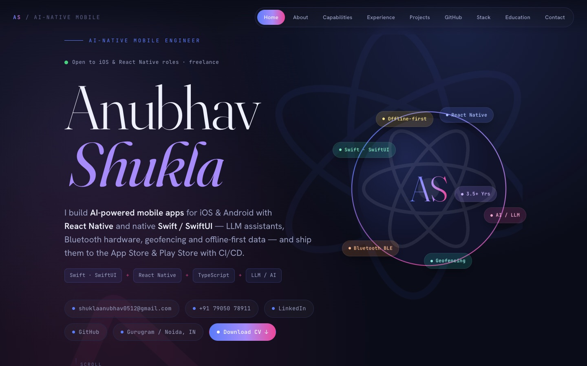
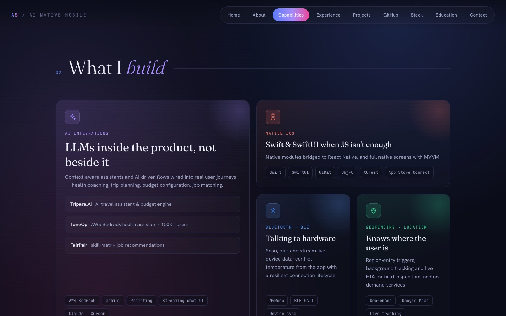
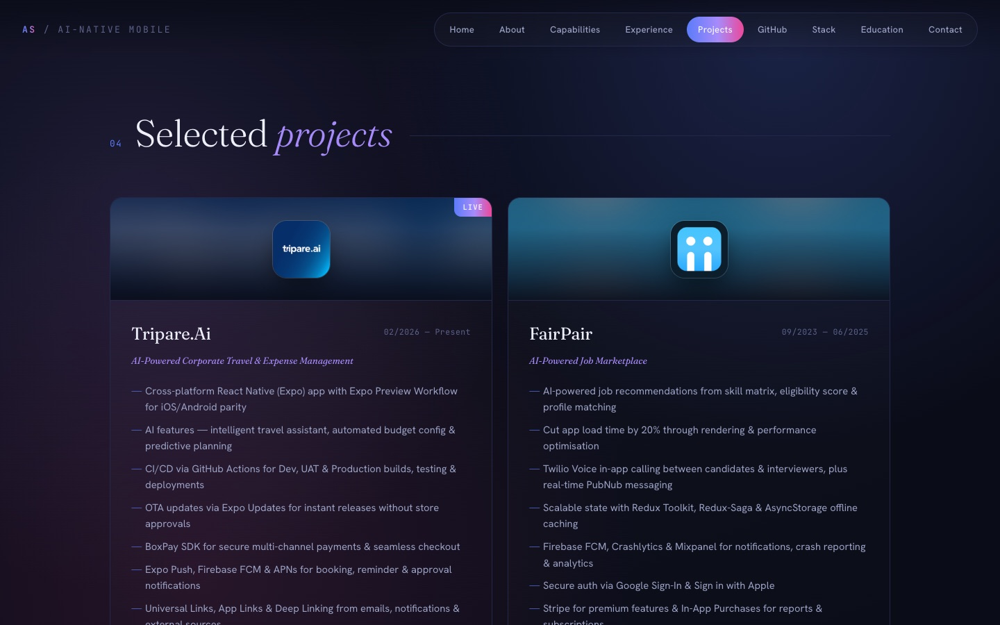
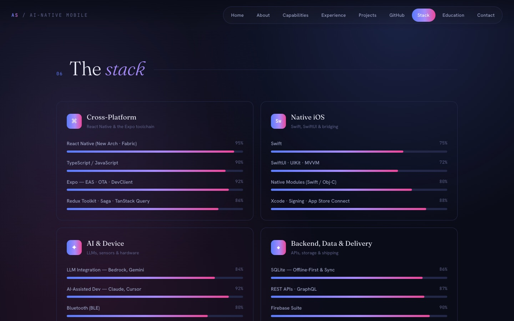
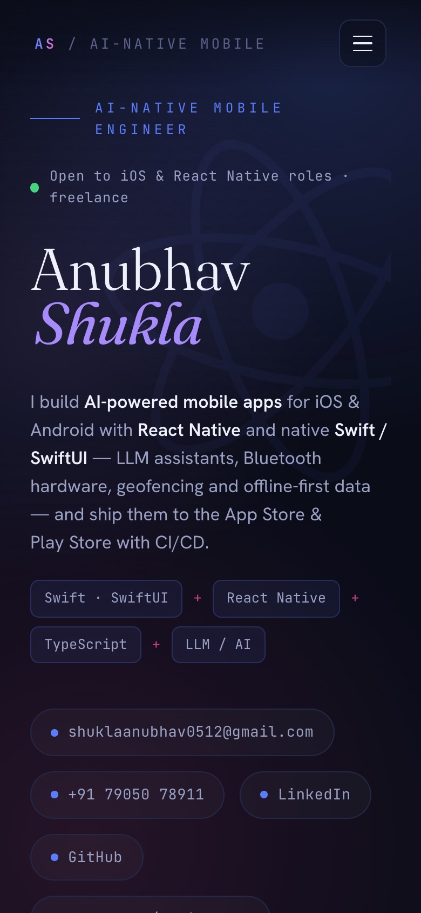

# Anubhav Shukla · Portfolio

> Personal portfolio of an **AI-Native Mobile Engineer** (React Native &amp; iOS / Swift). Hand-built in a single HTML file: no framework, no build step, no dependencies.

🔗 **Live:** [anubhav-shukla.netlify.app](https://anubhav-shukla.netlify.app)


<p align="center"></p>

<table>
  <tr>
    <td width="50%"><br><sub><b>What I build</b>: capability bento grid</sub></td>
    <td width="50%"><br><sub><b>Projects</b>: shipped apps with store links</sub></td>
  </tr>
  <tr>
    <td width="50%"><br><sub><b>Stack</b>: skill cards by area</sub></td>
    <td width="50%" align="center"><br><sub><b>Mobile</b>: fully responsive</sub></td>
  </tr>
</table>

## ✨ Features

| | |
|---|---|
| 🪶 **Zero dependencies** | One `index.html` with inline CSS &amp; JS. Only Google Fonts load from outside. |
| 🎨 **Design tokens** | Colours, radius and gradients defined once as CSS custom properties on `:root` |
| 🧭 **Scrollspy nav** | `IntersectionObserver` highlights the active section pill; hamburger menu below 1100px |
| 🎞️ **Scroll reveal** | Staggered fade-up animations, disabled under `prefers-reduced-motion` |
| 🔭 **Live GitHub feed** | The open-source section fetches my latest public repos from the GitHub REST API at runtime |
| 🖱️ **Micro-interactions** | Pointer-follow glow on project cards, orbiting skill badges, a cursor-trailing mascot |
| 📱 **Responsive** | Checked at 390 / 820 / 1440 px with no horizontal scroll |
| 🔎 **SEO &amp; sharing** | Meta description, Open Graph and Twitter card tags with a custom cover image |

## 📁 Structure

```
index.html          the whole site: markup, styles and scripts
Assets/             app icons, OG cover image, résumé PDF
docs/screenshots/   images used in this README
```

## 🚀 Run locally

No install needed. Open the file directly:

```bash
open index.html
```

Or serve it, so the GitHub fetch behaves exactly as in production:

```bash
npx serve .
```

## 📦 Deploy

Static hosting on Netlify: drag the folder into Netlify, or run `netlify deploy --prod`.

---

Built by **Anubhav Shukla** · [LinkedIn](https://www.linkedin.com/in/anubhav-shukla-6028041ab) · [GitHub](https://github.com/AnubhavReact)
